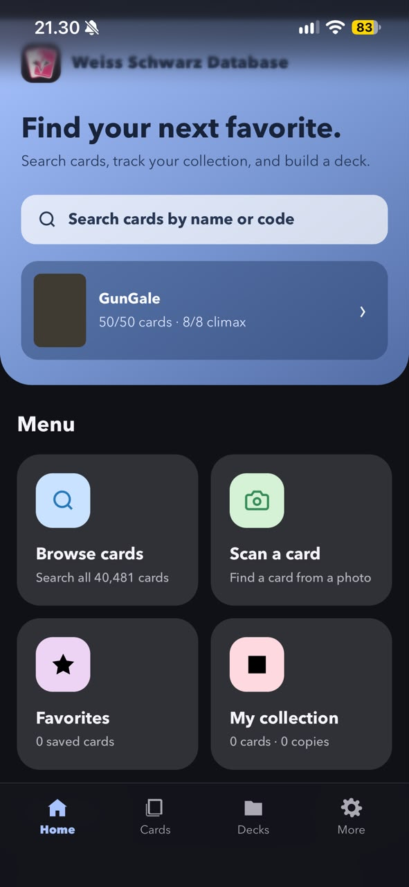

# Weiss Schwarz Database

A fast, phone-friendly database of **40,000+ Weiss Schwarz cards**. Search any card in seconds, keep your favorites and collection in one place, build decks, and scan a physical card with your camera to find it. It runs in the browser and installs on your home screen like a regular app.

  

## What you can do

**Find cards fast.** Search by name, card code, trait or effect text. Narrow results with colour, level, climax, favorite and stock filters, and pick a series and set. Switch between a large image grid and a text-friendly list.

**Read every card.** Open a card to see a big preview next to its full effect text, so you can read the card without squinting at the image.

**Scan a card.** Point the camera at the small card code printed above the name plate (for example `GGO/S59-037`), or pick a photo, and the app finds the matching card.

**Keep favorites.** Tap the star on any card to save it. Your favorites and recently viewed cards sit right on the home screen.

**Track your collection.** Set how many copies of each card you own and see your collection totals at a glance.

**Build decks.** Create as many decks as you like with a live counter for the 50-card total, climax limit and copy limit. Choose a cover card, copy or import a deck list, and export a deck as an image to share.

## Get it on your phone

Open the app's web address in your phone's browser, then add it to your home screen:

- **iPhone / iPad:** open it in Safari, tap **Share**, then **Add to Home Screen**.
- **Android:** open it in Chrome, then tap **Install app** (or menu → **Add to Home screen**).

After that it opens full screen from its own icon. Once you have opened it, the card database and the images you have viewed stay available even without a connection.

## Good to know

- Favorites, collection counts, decks and recently viewed cards are saved **on your device** (in the browser), so each device keeps its own.
- Card images come from official card images where available, and bundled card-image sheets are used as a fallback.
- The database follows the Japanese release. Licensed Western titles (Marvel, Disney family, Pixar, Star Wars), English-only titles (RWBY, Adventure Time, Avatar: The Last Airbender) and the discontinued WS Blau line are not included.
- Card scanning needs an internet connection the first time it is used, to load its text-recognition library.

## For developers

The app is a single static page (`index.html`) with the card data embedded, plus card-image sheets in `sheets/`. It is served with GitHub Pages straight from the `main` branch. Helper scripts used to rebuild the image sheets are in `tools/`, and the scan matching has tests in `tests/`.
